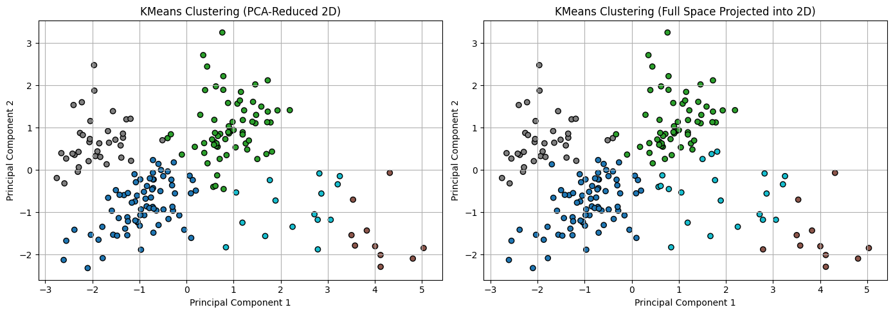
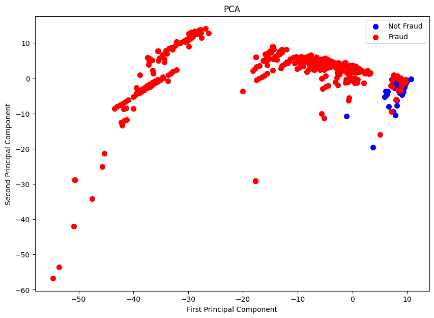
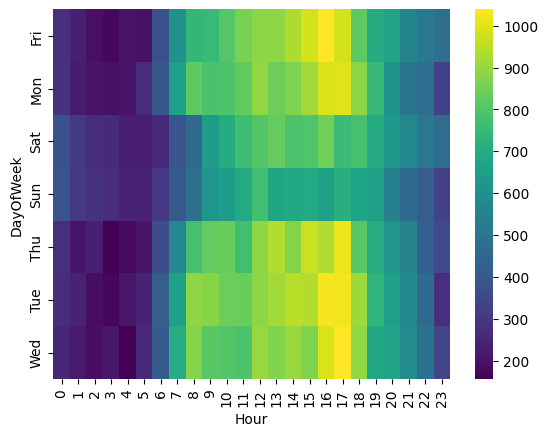
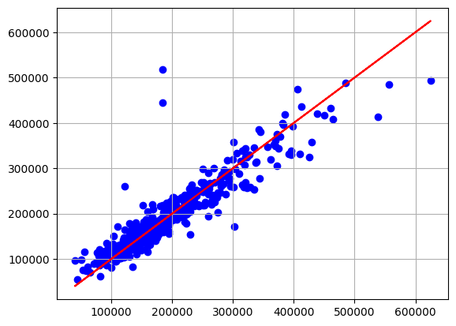
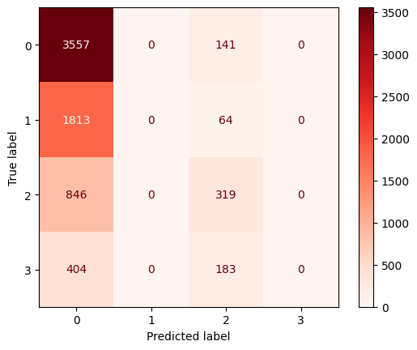
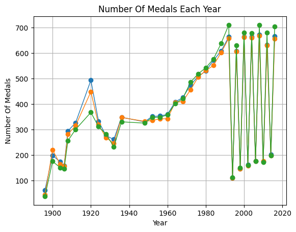
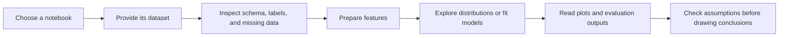

<div align="center">

# Data Analysis & Machine Learning Portfolio

### From a question to a notebook you can inspect.

**Exploratory Analysis · Statistical Experiments · Classification · Anomaly Detection**


[Project Index](#project-index) · [Visual Gallery](#visual-gallery) · [Run Locally](#run-locally) · [Dataset Checklist](#dataset-checklist)

</div>

## Overview

A collection of six notebooks covering emergency-call exploration, Olympic history, census-income classification, transaction anomaly detection, housing statistics, and supervised-learning comparisons.

This repository is the **collection view** of the work. Several topics also have dedicated repositories with project-specific documentation and, where available, bundled data. Start from the index below to choose the right notebook and understand its inputs before execution.

## Project Index

| Notebook | Focus | Companion Project |
|---|---|---|
| [911 Calls Project](911%20Calls%20Project.ipynb) | Category counts, timestamp features, daily trends, weekday/hour heatmaps | [911 Calls Analysis](https://github.com/ismailhalawa-ctrl/911-Calls-Analysis-) |
| [Olympics Project](Olympics%20Project.ipynb) | Participation records, medal entries, seasons, host cities, missing-data exploration | [Olympics Analysis](https://github.com/ismailhalawa-ctrl/Olympics-Analysis-Project-) |
| [ML and DL](ML%20and%20DL.ipynb) | Adult census data, encoded classification, Logistic Regression, Decision Tree, neural experiment | [Adult Income Analysis](https://github.com/ismailhalawa-ctrl/Adult-Income-Analysis) |
| [MLPROJECT](MLPROJECT.ipynb) | Balanced-sample clustering and full-dataset fraud/outlier evaluation | [Credit Card Fraud Detection](https://github.com/ismailhalawa-ctrl/Credit-Card-Froud-Detection) |
| [PROJECT(_2_)](PROJECT%28_2_%29.ipynb) | Garage-finish/price comparisons, Kruskal-Wallis, regression exercises | Housing statistics exercise |
| [machinproject(2)](machinproject%282%29.ipynb) | Encoded tabular classification, grid searches, model comparisons, RFE | Generic DataClass experiment |

The notebooks are separate experiments, not modules of one combined pipeline. Their filenames are preserved so existing references remain valid.

## Visual Gallery

Original saved figures from the portfolio notebooks are collected in [docs/figures](docs/figures). They are historical outputs, not newly rerun experiments.

<table>
<tr><td width="50%" align="center"><strong>Customer Segmentation</strong></td><td width="50%" align="center"><strong>Transaction Class Projection</strong></td></tr>
<tr><td></td><td></td></tr>
<tr><td align="center"><strong>Emergency-Call Patterns</strong></td><td align="center"><strong>Housing Predictions</strong></td></tr>
<tr><td></td><td></td></tr>
<tr><td align="center"><strong>Census Classification</strong></td><td align="center"><strong>Olympic Medal Entries</strong></td></tr>
<tr><td></td><td></td></tr>
</table>

The gallery also hosts figures from the dedicated Mall Customer and Ames Housing repositories; those notebooks are not part of this six-notebook collection.

## Analysis Workflow



## Dataset Checklist

Source datasets are **not bundled in this collection**.

| Notebook | Expected Input |
|---|---|
| 911 Calls Project | `/content/911.csv` |
| Olympics Project | `/content/athlete_events.csv` |
| ML and DL | `/content/adult.csv` |
| MLPROJECT | `creditcard.csv` |
| PROJECT(_2_) | `/content/project_2_data.csv` |
| machinproject(2) | `/content/DataClass.txt`, whitespace-delimited and headerless |

Use the dedicated repositories for the included Adult and 911 data. Obtain the remaining matching datasets separately and update loading paths. Do not assume similarly named housing datasets have identical schemas.

## Run Locally

```bash
git clone https://github.com/ismailhalawa-ctrl/Data-Analysis-Projects.git
cd Data-Analysis-Projects
python -m venv .venv
```

Activate the environment with `.\.venv\Scripts\Activate.ps1` in Windows PowerShell or `source .venv/bin/activate` on macOS/Linux.

```bash
python -m pip install numpy pandas matplotlib seaborn scikit-learn scipy statsmodels jupyterlab
jupyter lab
```

Install `tensorflow` separately when running the neural-network section of ML and DL. Change Colab `/content/...` paths to your local dataset locations and run one notebook from a clean kernel.

The repository does not include a dependency lock or an automated test suite. Full-dataset One-Class SVM and repeated parameter searches may take considerably longer than the exploratory plots.

## Experiment Notes

| Notebook | Important Context |
|---|---|
| 911 | Descriptive partial-period data, not an operational forecasting model |
| Olympics | Athlete-event rows and medal-bearing rows are not unique athletes or official event medal totals |
| ML and DL | Income labels with/without trailing periods create four classes; the binary neural output and NaN loss need correction |
| MLPROJECT | Clustering on a balanced sample and full-data outlier evaluation answer different questions |
| PROJECT(_2_) | Some cells reference undefined/mismatched variables, including `model` after fitting `m1`; review before running all cells |
| machinproject(2) | Some grid candidates are invalid (`"boly"`, `"l1 "`), and some reports/predictions reuse earlier-model variables |

For the statistics exercise, dropping missing values on a temporary column slice does not clean the original DataFrame. The custom contrast and ANOVA/OLS cells need review before treating them as valid inferential results.

For model comparisons, fit preprocessing on training data only, use consistent metrics, and verify that every prediction/report belongs to the intended estimator.

## Explore More Work

- [Mall Customer Segmentation](https://github.com/ismailhalawa-ctrl/Mall-Customer-Analysis)
- [Ames Housing Regression](https://github.com/ismailhalawa-ctrl/Ames-Housing-Analysis-)
- [Power BI Reports](https://github.com/ismailhalawa-ctrl/Power-Bi-Projects)
- [SentimentPRO](https://github.com/ismailhalawa-ctrl/SentimentPro-youtube)
- [Endpoint Log Analytics](https://github.com/ismailhalawa-ctrl/Endpoint-Log-Anomaly-Detection-Bot)

---

Created by **[Ismail Halawa](https://github.com/ismailhalawa-ctrl)**.

